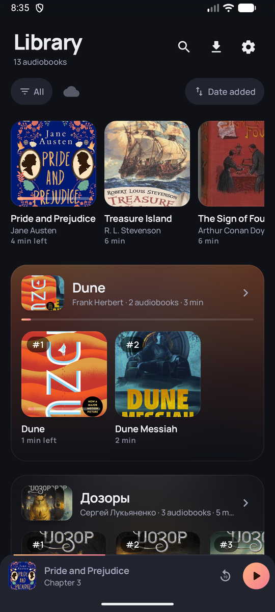
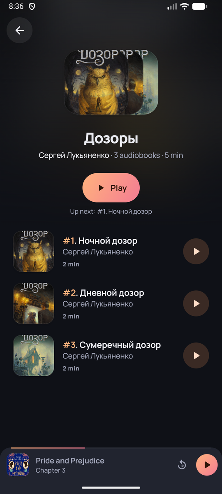
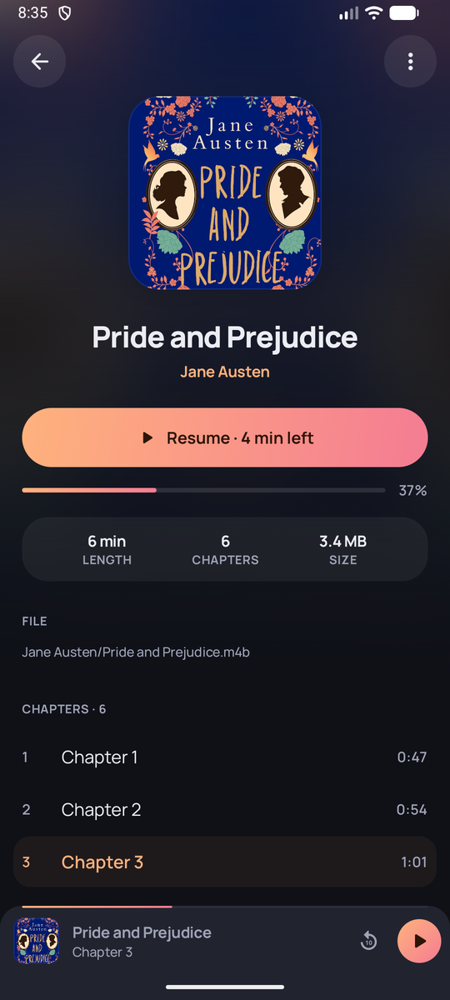
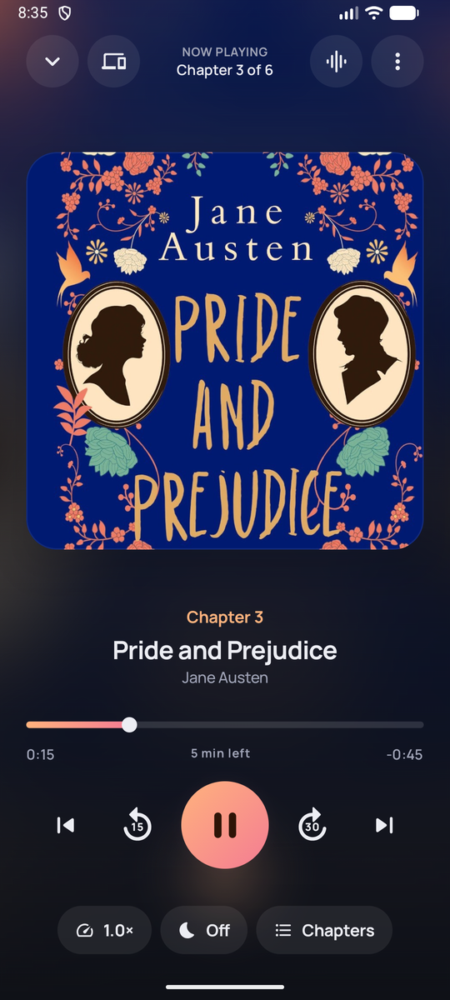
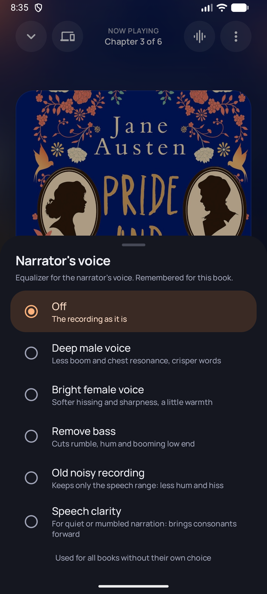
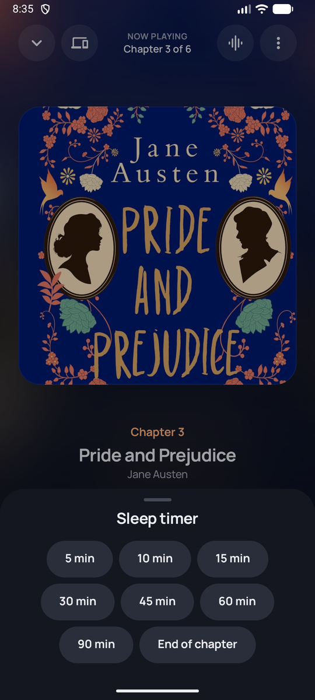
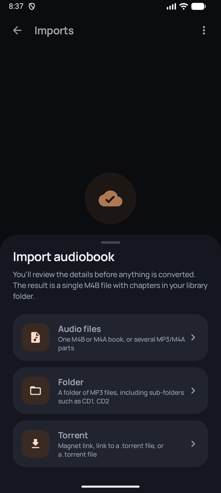
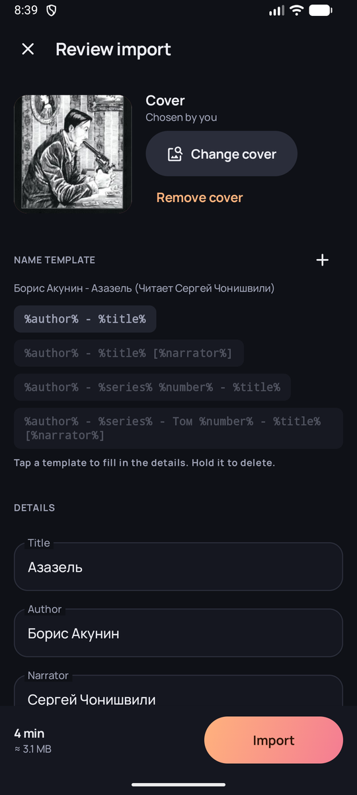
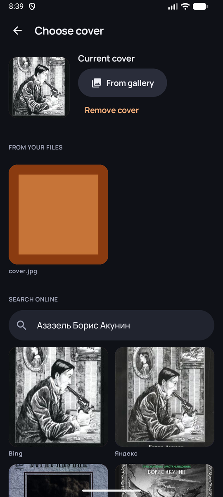

# BookSound

> [!WARNING]
> **This project is, at the moment, 100% AI-generated ("neuroslop") code.** Nearly every line
> was written by an LLM and has had little human review. Expect bugs, odd design decisions and
> code that may not hold up to scrutiny. Use it at your own risk and keep backups of your
> audiobooks.

A local-first audiobook player for Android. Import M4B/M4A files, folders of MP3s or torrents,
review and fix the metadata, and BookSound stores every book as a single M4B file (chapters,
cover, tags) in a folder you choose. No account and no cloud needed; an optional self-hosted
server adds a shared library, torrents converted at home, a web player and progress sync.

## Screenshots

| Library | Series | Book |
|:---:|:---:|:---:|
|  |  |  |

| Player | Narrator's voice | Sleep timer |
|:---:|:---:|:---:|
|  |  |  |

| Import | Review import | Cover search |
|:---:|:---:|:---:|
|  |  |  |

## Features

- **Your files, your folder.** The library is a folder you pick, laid out as
  `Author/Series/NN - Title.m4b`. Every book is one standard M4B that any other player can open.
- **Import from anywhere.** A single M4B/M4A, several MP3/M4A parts, a whole folder (including
  `CD1`, `CD2` sub-folders), or a torrent (magnet link, link to a `.torrent` file, or a `.torrent`
  file).
- **Review before converting.** Title, author, narrator, series and number, cover (from the file,
  your gallery or an online search) and name templates such as `%author% - %series% %number% - %title%`.
- **No needless re-encoding.** AAC sources are copied or joined as-is; everything else is
  converted to AAC. Several books can be imported side by side.
- **Safe imports.** Output is written to a temporary file, verified, and only then moved into
  the library. Cancelled, failed or interrupted imports clean up after themselves.
- **Torrents done carefully.** Only audiobook-shaped torrents are accepted, only the audio and
  cover files are downloaded, nothing is seeded, and downloads survive restarts and lost
  connections.
- **Series.** Books in a series are grouped together in the library and have their own screen
  that shows them in order and plays the next unfinished one.
- **A proper player.** Background playback with notification, lock screen and Bluetooth
  controls, chapters, per-book speed, sleep timer (minutes, end of chapter or book, with fade-out
  and shake to start it over), smart rewind after a pause, voice equalizer presets for the
  narrator, a volume boost for quiet recordings and skipping silence, all remembered per book, and
  "Listening starts": where each time you listened began, to go back there after falling asleep.
- **Rescans.** Each book carries an ID inside its M4B, so moved files are found again and books
  copied into the folder by hand are picked up.
- Dark and light themes, AMOLED black, English and Russian UI.
- **Optional server.** A shared library for the family, torrents downloaded and converted on a home
  server, books for phones and watches, listening progress synced per user, and a web app to listen
  in the browser. See [Server](#server).

## Requirements

Android 13 (API 33) or newer.

## Project layout

| Module | Contents |
|---|---|
| `:core` | Pure Kotlin/JVM, no Android: MP4/ID3/MP3 parsing, M4B tag and chapter writer, metadata guessing, file naming and library layout, search/sort/series grouping, torrent validation, sync contracts. |
| `:api` | The server's HTTP API types (kotlinx-serialization), shared by the server, phone and watch; generates the web app's TypeScript types. |
| `:torrent` | The libtorrent session wrapper used by the phone app and the server. |
| `:server` | The optional server: Ktor, SQLite, ffmpeg, libtorrent4j. Serves the web app. |
| `web/` | The web app: React, Vite, TypeScript, MUI. Built by Gradle (`:web`), which downloads its own Node. |
| `:app` | The Android app: Room, DataStore, Storage Access Framework, import pipeline (Media3 Transformer), torrents (libtorrent4j), playback (Media3 ExoPlayer + MediaSessionService), Jetpack Compose UI. |

## Server

The server is optional: the app works without it exactly as before. With it:

- **One library** in the same layout and M4B format as on the phone (`Author/Series/NN - Title.m4b`).
  A phone's library folder can simply be copied into the server's `library/` folder: books keep their ids.
- **Torrents and uploads converted on the server**, with the phone's rules: only audiobook-shaped torrents,
  only their audio and covers downloaded, nothing seeded, the same checks before a book enters the library.
- **Phones and watches** download books from it; watches can get a smaller copy made with a *watch profile*
  (bitrate, mono, sample rate, cover size), either when asked or ahead of time.
- **Progress per user**: several accounts share the library, each with their own positions and settings,
  synced between their phone, watch and browser.
- **Web app** at the server's address: library, player with chapters, speed, sleep timer and the narrator's
  voice presets, uploads, torrents, and administration.
- **Book details from audiobook sites** (akniga.org, knigavuhe.org): the server searches them and tells for
  each result whether it is the same recording (title, author, and the narrator or the length agree), the
  same book in another recording, or doubtful; the web app's edit dialog fills the chosen details and cover.
- **Books from knigavuhe.org**: paste a book's page on the web app's *Add* page; the server downloads its chapters
  (plain mp3 files the site's player lists with their lengths), checks them like a torrent's and makes one M4B with
  the site's details, cover and a chapter per file.

### Run it

**Docker** (amd64 and arm64; torrents need amd64, libtorrent has no arm64 Linux build):

```sh
sudo mkdir -p /srv/booksound && sudo chown 1001:1001 /srv/booksound   # the container runs as uid 1001
docker run -d --name booksound -p 8080:8080 -p 6881:6881 -p 6881:6881/udp \
  -v /srv/booksound:/data ghcr.io/hutao1love/booksound-server:latest
docker logs booksound 2>&1 | grep "setup token"
```

or [`deploy/docker-compose.yml`](deploy/docker-compose.yml).

**LXC container or any Debian/Ubuntu machine with systemd** (installs Java and ffmpeg, the latest release,
and a `booksound` service; run again to update):

```sh
curl -fsSL https://raw.githubusercontent.com/HuTao1Love/BookSound/main/deploy/lxc/install.sh | sh
journalctl -u booksound | grep "setup token"
```

Open `http://<server>:8080`, create the admin account with the setup token from the log, then add users on
the *Server* page.

Settings are environment variables (`/etc/booksound.env` for LXC):

| Variable | Default | |
|---|---|---|
| `BOOKSOUND_DATA` | `/data` (Docker), `/var/lib/booksound` (LXC) | Library, database, covers, watch copies, downloads. |
| `BOOKSOUND_PORT` | `8080` | Web app and API. |
| `BOOKSOUND_TRUSTED_PROXIES` | none | Addresses allowed to pass the client address and scheme in `X-Forwarded-*` (the router). |
| `BOOKSOUND_TORRENTS` | on | `off` disables torrents. |
| `BOOKSOUND_METADATA_SEARCH` | on | `off` stops looking book details up on audiobook sites and downloading books from knigavuhe.org (the server then fetches no outside pages). |
| `BOOKSOUND_FFMPEG` | `ffmpeg` | Path to ffmpeg. |
| `BOOKSOUND_UPDATER` | `systemd` (LXC), none | What installs updates from the admin page: `systemd` or `watchtower`. |
| `BOOKSOUND_WATCHTOWER_URL`, `_TOKEN` | none | Watchtower's HTTP API, for `BOOKSOUND_UPDATER=watchtower`. |

Bitrate, parallel conversions, torrent limits and watch profiles are set on the *Server* page.

### Updating

The *Server* page shows the latest release and installs it with *Install update*:

- **LXC**: `install.sh` adds `booksound-update.path`, a root unit that installs the latest release when the
  page asks (the server itself runs as a user that can't replace its program). Servers installed before it
  need `install.sh` run once more to get it.
- **Docker**: uncomment the `watchtower` service and the `BOOKSOUND_UPDATER`/`BOOKSOUND_WATCHTOWER_*` lines in
  [`deploy/docker-compose.yml`](deploy/docker-compose.yml) (same token on both sides). Without Watchtower
  the page shows the command instead: `docker compose pull && docker compose up -d`.

### Reaching it from the internet

The server has its own accounts (Argon2id passwords, rotating tokens for the apps, an HttpOnly cookie for
the browser, lockout after wrong passwords), so it needs no reverse proxy of its own. For HTTPS put any
TLS-terminating reverse proxy in front of it:

1. Proxy your domain, e.g. `books.example.com`, to the server's address and port `8080` over HTTP, and leave
   the proxy's own authorization **off** (the apps can't pass it).
2. Set `BOOKSOUND_TRUSTED_PROXIES` to the proxy's address, so the server sees the real client addresses
   (for its login limits) and that requests came over HTTPS.
3. In the app and the browser use `https://books.example.com`.

Without a proxy, open port 8080 only inside your network.

### Develop

```sh
./gradlew :server:run -Pport=8095     # data in server/run-data, web app built into the jar
cd web && npm run dev                 # optional: live-reloading web app on :5173, API proxied to :8080
./gradlew :api:generateTs             # after changing the API types
./gradlew :core:test :api:test :server:test
```
